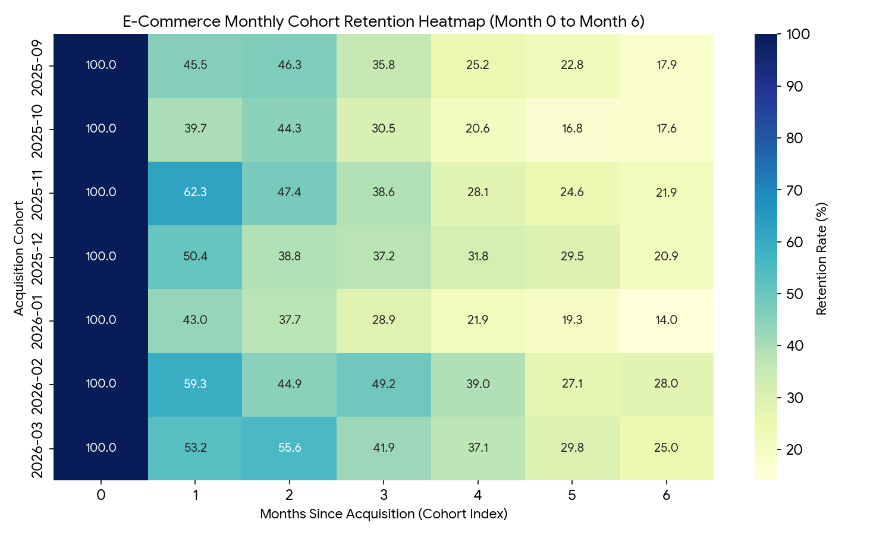
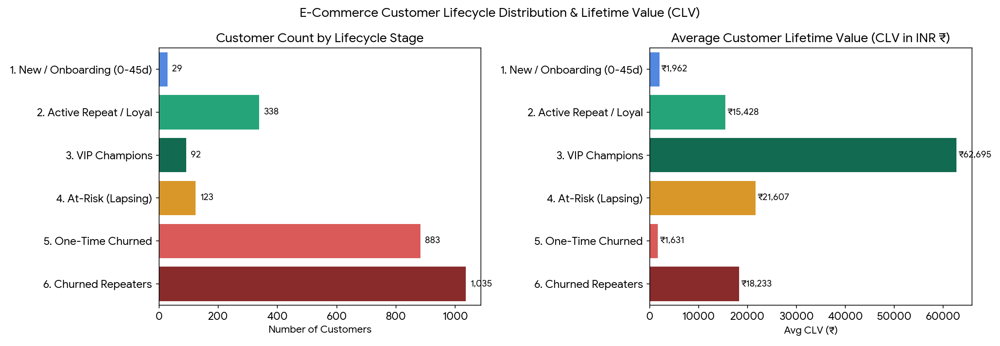

# E-Commerce Customer Lifecycle & Cohort Retention Analysis (SQL, Python & Power BI)

[]()
[]()
[]()

## Overview
An end-to-end **Customer Lifecycle Analytics** project designed for Indian e-commerce (INR ₹) tracking **2,500 customers** across the complete lifecycle funnel: **Acquisition $
ightarrow$ Onboarding/Activation (2nd-Order Conversion) $
ightarrow$ Active Retention $
ightarrow$ VIP Advocacy $
ightarrow$ Lapsing/Churn Win-Back**.

---

## Repository Structure
```text
ecommerce-customer-lifecycle-analysis/
├── data/
│   ├── ecommerce_customers.csv           # 2,500 customer profiles with acquisition cohort & channel
│   ├── ecommerce_orders.csv              # Granular order history with order sequence numbers
│   └── customer_lifecycle_summary.csv    # Enriched table with CLV, recency & lifecycle stage tags
├── sql/
│   └── lifecycle_cohort_analysis.sql     # SQL queries for lifecycle staging, 2nd-order velocity & channel CLV
├── src/
│   └── lifecycle_analysis.py             # Python lifecycle classification & cohort KPI engine
├── powerbi/
│   └── Lifecycle_DAX_Measures.dax        # Power BI DAX measures for Repeat Rate, CLV & At-Risk Revenue
├── images/
│   ├── cohort_retention_heatmap.png      # Month 0 to Month 6 cohort retention heatmap
│   └── lifecycle_stages_clv.png          # Customer volume & average CLV across lifecycle stages
└── README.md
```

---

## Customer Lifecycle Stages & Strategy

| Lifecycle Stage | Definition | Strategic Intervention |
| :--- | :--- | :--- |
| **1. New / Onboarding (0–45d)** | 1 order placed within the last 45 days | Trigger automated Day-15 & Day-30 product recommendation nudges to secure the 2nd order |
| **2. Active Repeat / Loyal** | 2–7 orders with last purchase $\le$ 75 days | Enroll in tiered loyalty points and cross-sell complementary categories |
| **3. VIP Champions** | 8+ orders with last purchase $\le$ 60 days | Provide early sale access, free express shipping, and referral bonuses |
| **4. At-Risk (Lapsing)** | 2+ orders, inactive for 76–135 days | Launch personalized win-back offers before permanent churn occurs |
| **5. One-Time Churned** | 1 order only, inactive > 45 days | Low-cost remarketing during major festive events |
| **6. Churned Repeaters** | 2+ historical orders, inactive > 135 days | Survey exit feedback & deploy high-intent reactivation vouchers |

---

## Visual Insights



---

## How to Run
```bash
pip install pandas numpy matplotlib seaborn
python src/lifecycle_analysis.py
```
To explore in SQL or Power BI, load `data/customer_lifecycle_summary.csv` and `data/ecommerce_orders.csv` using the scripts in `sql/` and `powerbi/`.
